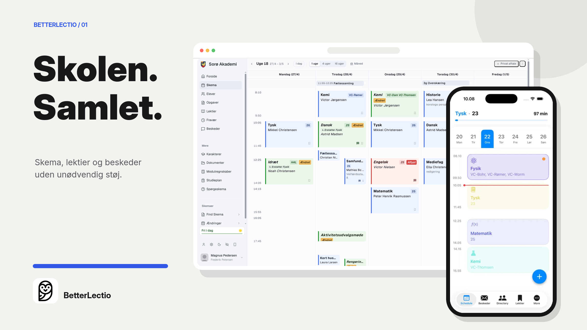

# BetterLectio website

The public website for [BetterLectio](https://betterlectio.dk/), a modern way to use Lectio on the web, iPhone, and Android. The site explains the product, helps students find the right download, and hosts BetterLectio's public feedback, roadmap, school, statistics, privacy, and press pages.



## What the site does

- Introduces BetterLectio with real product previews and download links.
- Routes visitors to the correct browser extension or mobile app.
- Publishes the roadmap, feedback board, usage statistics, and school pages.
- Provides the press kit and product assets.
- Handles referral links and the secure login handoff used by BetterLectio Events.

## Run it locally

Install [Bun](https://bun.sh/), then run:

```bash
bun install
bun run dev
```

Open [http://localhost:3000](http://localhost:3000). The main marketing pages work without private credentials. Features backed by Supabase or PostHog need their matching environment variables.

Useful checks:

```bash
bun run typecheck
bun run lint
bun run build
```

## Configuration

Create `.env.local` when you need connected features:

| Variable | Used for |
| --- | --- |
| `SUPABASE_URL` | Server-side Supabase access |
| `SUPABASE_SERVICE_ROLE_KEY` | Trusted server actions and public data reads |
| `NEXT_PUBLIC_SUPABASE_ANON_KEY` | Browser-safe Supabase authentication |
| `NEXT_PUBLIC_POSTHOG_KEY` | Product analytics |
| `NEXT_PUBLIC_POSTHOG_HOST` | PostHog API host |
| `POSTHOG_API_KEY` and `POSTHOG_PROJECT_ID` | Public statistics |
| `BETTERLECTIO_EVENTS_URL` | BetterLectio Events login destination |

Never expose the Supabase service-role key to browser code.

## Project map

- `app/` contains pages, route handlers, metadata, and public auth flows.
- `components/site/` contains the marketing site and public product components.
- `lib/` contains Supabase, PostHog, download, school, and referral helpers.
- `public/shots/` contains product screenshots used on the site.
- `public/press/` contains downloadable press and product assets.

The app is built with Next.js, React, TypeScript, Tailwind CSS, Supabase, and PostHog.
